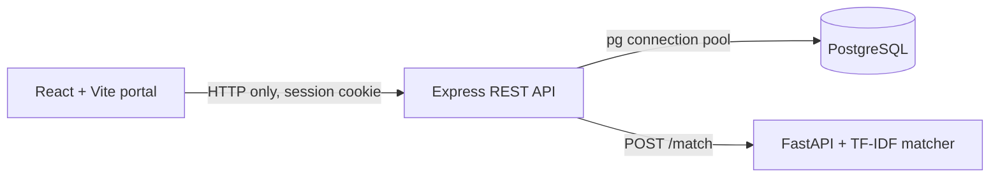

# Unified Campus Placement and Eligibility Intelligence System

An academic project prototype for Sahyadri College of Engineering & Management (SCEM), Adyar, Mangaluru. It brings student profiles, placement drives, rule-based eligibility, applications, spreadsheet imports, recruiter review, interviews, offers, analytics, and local resume matching into one web application.

**Academic Project Prototype | Sahyadri College of Engineering & Management**

This is a student-developed local prototype. It is not officially deployed, endorsed, approved, or connected to SCEM's student, recruiter, or placement systems. All seeded people and outcomes are synthetic. The college's [public website](https://www.sahyadri.edu.in/), [programs](https://www.sahyadri.edu.in/departments), and [placement page](https://www.sahyadri.edu.in/placements) informed the institutional context and labels only.

## Project overview

The system separates three concerns:

- **Eligibility** is a backend rule check of CGPA, active backlogs, branch, drive publication, and deadline. Its result is saved as an application-time snapshot.
- **Resume matching** calculates TF-IDF/cosine text similarity and skill overlap in a local Python service. It does not affect mandatory eligibility and is not a hiring probability.
- **Access control** uses a server-side role and recruiter-to-company relation. Public registration can create only a student account and must match an imported roster record.

## Technology

- React 19, Vite 8, React Router 7, Axios, Chart.js.
- Node.js 20.19+ or 22.12+ (Vite 8 requirement) and Express 4; PostgreSQL 14+ with parameterized `pg` queries and SQL migrations.
- Python 3.11+ and FastAPI with scikit-learn.
- bcrypt password hashes, signed HTTP-only session cookies, Zod validation, Helmet, CORS, and rate limiting.

## Roles and features

**Students** register against an imported roster, review and update contact/resume text, browse published drives, see eligibility explanations, apply, follow interview/offer status, and request resume feedback.

**Placement officers** maintain companies and drives, search the student directory, preview and confirm CSV/XLSX roster imports, review applications, record interview rounds and offers, and view database-derived reports.

**Recruiters** are assigned to one company by the Placement Cell. They see only that company's drives and applicants, can review authorized resume text, update permitted review statuses, and record interview rounds.

## Architecture



The Express API is the only application component that connects to PostgreSQL. See [architecture diagrams](docs/architecture.md), [database design](docs/database-design.md), and [API documentation](docs/api-documentation.md).

## Requirements

- Node.js 20.19+ or 22.12+ with npm.
- PostgreSQL 14 or newer, running locally or reachable through `DATABASE_URL`.
- Python 3.11 or newer for resume matching.
- The API and frontend can be used while the AI service is offline; only resume matching is unavailable.

## Setup on Windows PowerShell

1. Install PostgreSQL and create a development database (for example, in `psql`):

   ```sql
   CREATE ROLE scem_dev LOGIN PASSWORD 'choose-a-local-password';
   CREATE DATABASE scem_placement OWNER scem_dev;
   ```

2. In the project root, install the JavaScript workspaces and configure local secrets:

   ```powershell
   npm install
   Copy-Item backend/.env.example backend/.env
   Copy-Item frontend/.env.example frontend/.env
   ```

   Edit `backend/.env`: set `DATABASE_URL` and generate a random `JWT_SECRET` with at least 32 characters. Set both development officer values and/or both recruiter values to create those role accounts during seeding. Do not commit `.env` files.

   ```powershell
   $secretBytes = New-Object byte[] 48
   [System.Security.Cryptography.RandomNumberGenerator]::Fill($secretBytes)
   $jwtSecret = [Convert]::ToBase64String($secretBytes)
   ```

   Copy the resulting random value into `JWT_SECRET` in `backend/.env`. For demo officer access, set `DEV_OFFICER_EMAIL` and `DEV_OFFICER_PASSWORD` (at least 12 characters). For recruiter access set `DEV_RECRUITER_EMAIL` and `DEV_RECRUITER_PASSWORD` as well. The seed script creates accounts only when the matching pair is provided.

3. Apply migrations and load synthetic development data:

   ```powershell
   npm --workspace backend run db:migrate
   npm --workspace backend run db:seed
   ```

   The SQL seed creates three synthetic companies, 12 synthetic students, academic records, three drives, sample applications, an interview round, and a pending offer. The values are demonstration data, not a real SCEM roster or placement report. Re-running seed is safe for duplicate sample records; it does not drop the database.

4. Install the AI service and run the web app:

   ```powershell
   py -3.11 -m venv ai-service/.venv
   .\ai-service\.venv\Scripts\Activate.ps1
   python -m pip install -r ai-service/requirements.txt
   deactivate
   npm run dev
   ```

   The `dev` command starts the Express API on port 4000, Vite on port 5173, and the Python service on port 8000. If `py -3.11` is not available, use the full path to your Python 3.11+ executable to create the virtual environment. Keep PostgreSQL running in a separate process.

5. Open `http://localhost:5173`. The API check is `http://localhost:4000/api/health`; the matcher check is `http://localhost:8000/health`.

### Linux/macOS equivalent

```bash
# Create the scem_placement database with a local PostgreSQL role first.
npm install
cp backend/.env.example backend/.env
cp frontend/.env.example frontend/.env
# Edit backend/.env with DATABASE_URL, a random JWT_SECRET, and optional DEV_* account credentials.
npm --workspace backend run db:migrate
npm --workspace backend run db:seed
python3.11 -m venv ai-service/.venv
source ai-service/.venv/bin/activate
python -m pip install -r ai-service/requirements.txt
deactivate
npm run dev
```

## Local account setup

Public student registration is available from the sign-in page. A student must supply the exact imported name, registration number, and contact email. The demo roster contains synthetic entries such as `DEMO2026CSE001` / `Aarav Rao` / `aarav.rao@demo.example`. Choose a new password of at least 10 characters. A student password is not seeded or shared.

Placement officer and recruiter accounts are created through environment variables before running `db:seed`. The recruiter is linked to the synthetic Northstar Systems company. Public account registration never accepts a role field.

## Bulk import

Download the template within the Placement Cell portal. Upload CSV or XLSX, review every row result, then confirm the preview. Required columns, validation rules, duplicate behavior, preview expiry, and error report handling are described in [docs/data-import.md](docs/data-import.md). Existing registration numbers are skipped; imports never silently overwrite student records.

## Database and SQL reports

The initial migration is `backend/database/migrations/001_initial.sql`; migration progress is stored in `schema_migrations`. Reapply migrations with `npm --workspace backend run db:migrate`. `backend/database/queries.sql` contains more than 15 reporting and SQL examples. The database ER diagram and constraints are in [docs/database-design.md](docs/database-design.md).

## Tests and builds

```powershell
npm test
npm run build
```

Backend unit tests use Node's built-in test runner. Python matcher tests can be run after installing the AI requirements:

```powershell
python -m unittest discover -s ai-service/tests
```

The test set exercises eligibility boundaries, status transitions, CSV quoting/error handling, and AI score/skill behavior. Full route/database integration requires a configured PostgreSQL test database; details and executed results belong in [docs/testing.md](docs/testing.md). This project does not automatically run destructive reset commands.

## AI method and limitations

The local matcher normalizes whitespace, uses TF-IDF (unigrams and bigrams, English stop words), and measures cosine similarity. It extracts a maintainable skills vocabulary and suggests considering job-description skills not found in resume text. It may miss synonyms, context, equivalent experience, and skills outside its vocabulary. Similarity is text overlap, not a hiring probability, proof of competence, or decision signal. Resume content is sent only to the local Python service after the student explicitly requests a match.

## Resetting local development data

Seeding is additive and safe to rerun. To intentionally start fresh, stop the services, back up anything needed, and use a separately named local development database. Drop/recreate commands are intentionally not part of startup or seed scripts.

## Known limitations and next steps

- Roster account linking uses exact imported name, registration number, and email as a prototype verification step. A production deployment would need an institution-approved identity verification flow.
- Resume upload currently accepts plain text only; PDF and DOCX parsing are not implemented.
- Import previews are per-user, staged in PostgreSQL, and expire after a configurable interval; automatic removal of expired staging rows needs a retention job.
- Analytics are based on current prototype database records. Seed rows are synthetic. Acceptance of offers is distinct from an offer being created.
- The app uses a text wordmark fallback and a restrained dashboard style. No official logo asset is redistributed.
- No external AI API, email service, institutional login, or college database connection is configured.

## Institutional reference

The public college pages list Computer Science and Engineering (CSE), Computer Science and Engineering (Artificial Intelligence and Machine Learning) (CSE-AIML), Information Science and Engineering (ISE), Electronics and Communication Engineering (ECE), Electronics and Computer Engineering (internal prototype code `EC`), and Mechanical and Robotics Engineering (internal prototype code `MECH-ROBOTICS`). Codes are configurable records, not evidence of current enrollment. The footer label and public links are configurable in `college_settings`.
