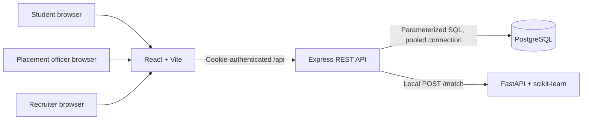
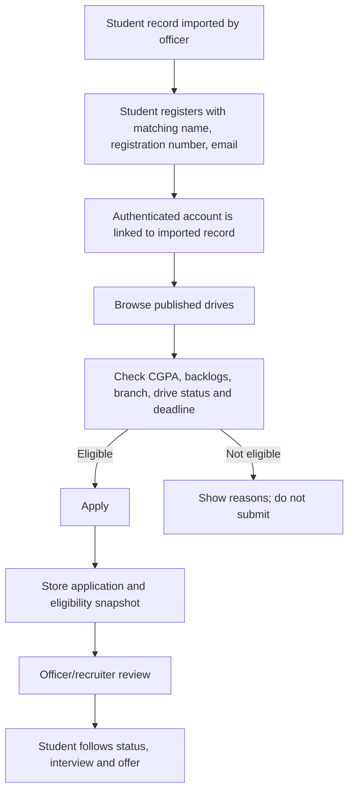
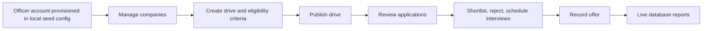
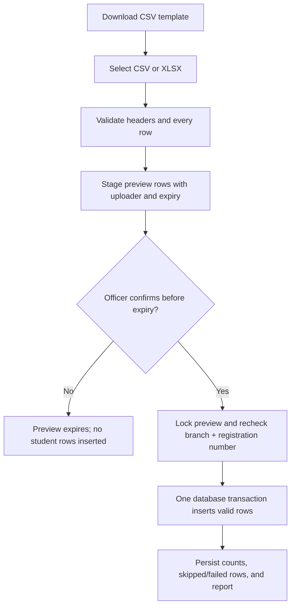
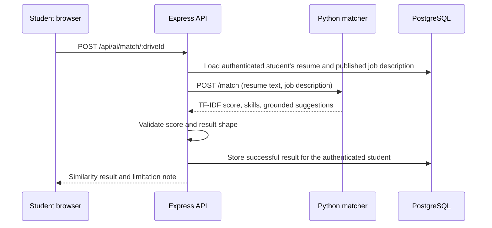

# Architecture and workflows

## System components

## Student placement workflow

## Placement officer workflow

## Bulk import workflow

## AI resume matching workflow

Express owns authentication, authorization, data validation, and persistence. The Python service has no database credentials. Core workflows continue if the matcher is unavailable.
