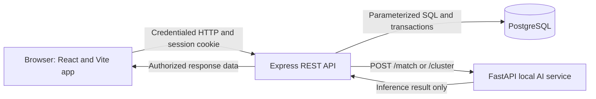

# Architecture and technical overview

> **Purpose:** Explain the running system's components and data flow.  
> **Updated:** 2026-10-20  
> **Source authority:** Current source code and SQL migrations; descriptions below are code-inspected, not a deployment diagram.

## Contents

- [Overview](#overview)
- [Technology stack](#technology-stack)
- [System diagram](#system-diagram)
- [Request flow](#request-flow)
- [Authentication and roles](#authentication-and-roles)
- [Core workflows](#core-workflows)
- [Database responsibilities](#database-responsibilities)
- [Local development](#local-development)
- [Limitations](#limitations)
- [Related documentation](#related-documentation)

## Overview

The browser uses a React single-page application. It sends credentialed HTTP requests to an Express API. Express handles identity, authorization, validation, business rules, and PostgreSQL reads and writes. For resume matching and student grouping, Express calls a local FastAPI service. FastAPI has no database connection; Express remains the application database boundary.

The important code locations are `frontend/src/`, `backend/src/`, `backend/database/`, and `ai-service/app/`. PostgreSQL schema changes are versioned under `backend/database/migrations/`.

## Technology stack

| Technology | Responsibility | Why it fits this prototype |
|---|---|---|
| React 19, React Router 7 | Role-specific pages, forms, tables, dialogs, and navigation. | Component-based interface and client-side route gating. |
| Vite 8 | Frontend development server and production build. | Fast local iteration and a static deployable frontend bundle. |
| Axios | Browser API requests. | Shared API base URL and credentialed cookie requests. |
| Chart.js / react-chartjs-2 | Placement Cell dashboard and report charts. | Renders charts from current API/database response data. |
| Express 4 on Node.js | HTTP API, input validation, authentication, authorization, workflows, and service orchestration. | Keeps data access and trusted rules on the server. |
| PostgreSQL with `pg` | Relational records, constraints, transactions, views, and indexes. | Supports the project's DBMS requirements and durable placement records. |
| FastAPI and scikit-learn | Local resume similarity and on-demand K-Means inference. | Provides a small Python service for the project's ML methods. |
| bcryptjs, JSON Web Token, Zod | Password hashing, signed sessions, and request validation. | Implements account protection and explicit API input contracts. |

The rationale column is an explanation of how the current implementation uses the tools, not a claim about a recorded selection process.

## System diagram



## Request flow

1. The browser loads a route and, for protected pages, asks the API for the current session identity.
2. The API validates the session cookie or bearer token. It reloads the user, active state, role, and session version from PostgreSQL.
3. The route validates input, checks ownership and role, and applies its server-side workflow rules.
4. Express queries PostgreSQL using bound parameters. Multi-step writes use a transaction where atomicity matters.
5. For an AI operation, Express sends only the required text/features to FastAPI, validates the returned structure, and persists a resume-match result if the operation is a match. Clustering results remain transient.
6. Express returns data or a useful error. The frontend renders its loading, success, empty, or error state.

## Authentication and roles

`backend/src/routes/auth.js` implements student registration, role-selected login, logout, session lookup, and password recovery. The session is an eight-hour signed JWT in an HTTP-only cookie. `backend/src/middleware/auth.js` reloads the current user and enforces active state and session-version checks. `backend/src/routes/officer.js` applies placement-officer authorization to its router; student and recruiter resources also check their ownership boundaries.

The browser route guards improve navigation but are not the security boundary. The API remains authoritative. Recruiter authorization is derived from the authenticated recruiter's company relation, and import report queries include the authenticated uploader. See [security](security.md) and the route inventory in [API documentation](api-documentation.md).

## Core workflows

### Student directory and roster import

The officer API reads roster rows from `students` joined to `branches`, with registration/account/activity data. It supports search, department, intake-year, registration-status filtering, pagination, and department/cohort summaries. CSV/XLSX imports are parsed in memory, staged as an officer-owned preview, then confirmed once within a transaction. Account registration remains a separate workflow.

### Rule-based eligibility

`backend/src/services/eligibility.js` checks for known academic values, minimum CGPA, maximum active backlogs, active/allowed branch, published drive status, and an open deadline. Applying repeats the trusted checks on the server and stores an eligibility snapshot. Resume scores and cluster labels are not inputs to this decision.

### Resume matching

The student route calls `POST /api/ai/match/:driveId`. Express loads the authenticated student's saved resume text and the selected published drive's description, then calls FastAPI `POST /match`. `ai-service/app/matcher.py` normalizes whitespace, builds TF-IDF unigram/bigram vectors with English stop words, and computes cosine similarity. A finite recognized-skills vocabulary produces matched/missing skills and text suggestions. Successful output is stored in `ai_match_results` for the student and drive. The result is descriptive text overlap, not a hiring probability.

### K-Means student grouping

An officer explicitly requests `POST /api/officer/student-groups`. Express reads the current roster and sends only CGPA, active backlog count, and resume text to `POST /cluster`. FastAPI extracts recognized skills, imputes/scales numeric features, normalizes the feature blocks, and fits deterministic scikit-learn K-Means. Unless a cluster count is supplied, it selects a valid count from 2 through 8 using silhouette score. Express validates cluster memberships and maps them to authorized roster display fields. The response is on demand and is not stored in PostgreSQL.

The grouping does not use student names, contact details, departments, graduation years, or account credentials as model features. It includes both eligible and ineligible students and does not predict hiring or replace eligibility.

## Database responsibilities

PostgreSQL stores users and roles, branches, student roster and academics, companies/recruiters, drives and allowed branches, eligibility configuration, applications and their historical snapshots, interview rounds, offers, match results, import previews, status history, and institution display settings. The API relies on primary/foreign keys, uniqueness, check constraints, indexes, SQL transactions, the `drive_application_summary` view, and updated-at triggers.

See [database design](database-design.md) for the ER diagram, cardinalities, keys, delete actions, and normalization discussion. The migrations are authoritative if the diagram or prose ever differs.

## Local development

Run PostgreSQL separately, configure local environment files from the examples, then start the three app services from the project root with:

```powershell
npm run dev
```

The root script starts the API, Vite, and `python ai-service/run.py` concurrently. The Python runner uses `ai-service/.venv` when present and listens on loopback port 8000. Default local URLs are `http://localhost:5173`, `http://localhost:4000/api/health`, and `http://localhost:8000/health`. Exact Windows setup and configuration steps are in [setup-windows](setup-windows.md). Do not rerun migrations or seed commands against valuable databases as part of normal startup.

## Limitations

- This is a local academic prototype; production hosting, operational monitoring, backups, and institution-managed identity are outside scope.
- The API is the only database owner; the FastAPI process is local and has no persistence.
- Resume parsing has no OCR for scanned/image-only PDFs. Similarity and recognized-skill suggestions have vocabulary and synonym limits.
- K-Means is exploratory, current-roster-only, and not persisted. Insufficient or identical profiles may not form useful clusters.
- Expired import previews have no scheduled retention cleanup.
- Current reports describe records in this prototype database. Synthetic seed data is not institutional evidence.

## Related documentation

[Product requirements](PRD.md) · [Design and pages](DESIGN.md) · [Test plan and evidence](TEST_PLAN.md) · [Security](security.md) · [Decisions](DECISIONS.md) · [AI handoff](MEMORY.md)
