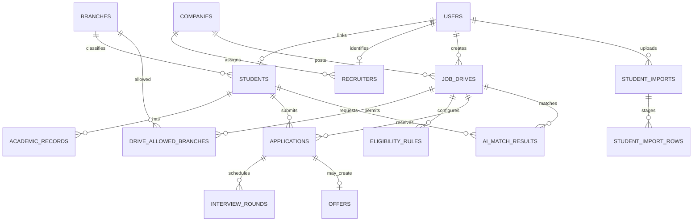

# Database design

## Entity relationships

## Tables

| Table | Purpose |
|---|---|
| `users` | Login identities and trusted roles; passwords are bcrypt hashes. |
| `branches` | Configurable normalized department/program options. |
| `students` | Imported academic roster, optionally linked to one user. Keeps contact email for safe roster account linking. |
| `academic_records` | Per-semester SGPA and backlog details. |
| `companies`, `recruiters` | Employer profiles and explicit recruiter-to-company scope. |
| `job_drives` | Company roles, deadlines, mandatory eligibility thresholds, and publication state. |
| `drive_allowed_branches` | Explicit branch allowlist. Zero rows means all currently active branches. |
| `eligibility_rules` | Typed rule storage with an allowlist; executable strings are never evaluated. Core numeric criteria are also first-class columns on `job_drives`. |
| `applications` | One student/drive application with a criteria snapshot and workflow status. |
| `interview_rounds`, `offers` | Interview schedule/outcomes and at most one offer per application. |
| `ai_match_results` | Structured local matching output scoped to a student and drive. |
| `student_imports`, `student_import_rows` | Import history and per-user staged preview with row result. |
| `college_settings` | Non-secret institutional label and public links. |
| `schema_migrations` | Applied SQL migration names. |

## Integrity and normalization

UUID primary keys are generated by PostgreSQL. Foreign keys use `RESTRICT` where deleting a branch/company would invalidate historical drives or student records, and `CASCADE` for child records that have no independent meaning. Roles, drive state, application state, interviews, offer state, numeric ranges, and uniqueness constraints are enforced in SQL as well as checked at the API boundary. Registration numbers have both a unique field constraint and a case-insensitive unique index.

`students.user_id` is nullable and unique so imports can precede registration. Student registration is limited to an existing registration number, roster name, and imported contact email. Students can update contact phone and resume text, but cannot modify official academic fields. Application snapshots are written once at application time and are not rewritten by later checks.

Empty `drive_allowed_branches` means any branch with `is_active=true` at eligibility time; one or more rows means an explicit allowlist. Import staging is separate from `students`; preview and final insertion are different transactions. `ON CONFLICT DO NOTHING` plus the unique registration number prevents duplicate rows without overwriting an existing student.

Indexes cover branch/student filters, drive status/deadline, company scope, application status, interview lookup, AI history, and import history/rows. `backend/database/queries.sql` documents reporting joins, aggregates, a rate definition, a view, and a window query.
