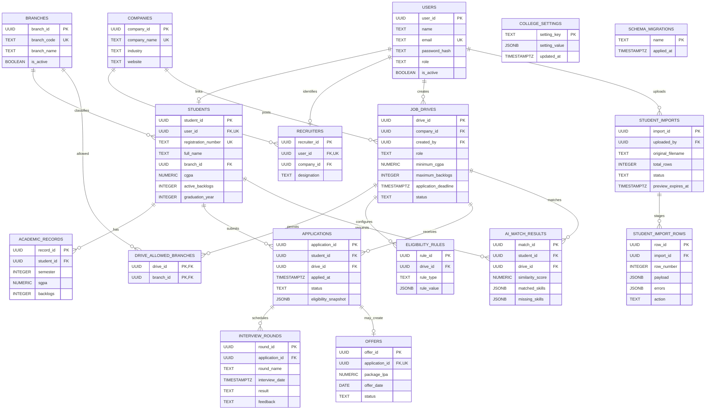

# Database design

## Entity relationships

## Tables

| Table | Purpose |
|---|---|
| `users` | Login identities and trusted roles; passwords are bcrypt hashes. |
| `branches` | Configurable normalized department/program options. |
| `students` | Imported academic roster, optionally linked to one user. Keeps contact email for safe roster account linking. |
| `academic_records` | Per-semester SGPA and backlog details. |
| `companies`, `recruiters` | Employer profiles and explicit recruiter-to-company scope. |
| `job_drives` | Company roles, deadlines, mandatory eligibility thresholds, and publication state. |
| `drive_allowed_branches` | Explicit branch allowlist. Zero rows means all currently active branches. |
| `eligibility_rules` | Typed rule storage with an allowlist; executable strings are never evaluated. Core numeric criteria are also first-class columns on `job_drives`. |
| `applications` | One student/drive application with a criteria snapshot and workflow status. |
| `interview_rounds`, `offers` | Interview schedule/outcomes and at most one offer per application. |
| `ai_match_results` | Structured local matching output scoped to a student and drive. |
| `student_imports`, `student_import_rows` | Import history and per-user staged preview with row result. |
| `college_settings` | Non-secret institutional label and public links. |
| `schema_migrations` | Applied SQL migration names. |

## Integrity and normalization

UUID primary keys are generated by PostgreSQL. Foreign keys use `RESTRICT` where deleting a branch/company would invalidate historical drives or student records, `SET NULL` where an identity may be deactivated or removed without deleting the roster/history, and `CASCADE` for child records that have no independent meaning. Roles, drive state, application state, interviews, offer state, numeric ranges, and uniqueness constraints are enforced in SQL as well as checked at the API boundary. Migration `004_normalized_registration_number.sql` enforces registration-number uniqueness after trimming and uppercasing. CGPA and SGPA use `NUMERIC(4,2)` so `10.00` is representable; migration `003_allow_perfect_gpa.sql` widens existing installations.

`students.user_id` is nullable and unique so imports can precede registration. Student registration is limited to an existing registration number, roster name, and imported contact email. Students can update contact phone and resume text, but cannot modify official academic fields. Application snapshots are written once at application time and are not rewritten by later checks.

Empty `drive_allowed_branches` means any branch with `is_active=true` at eligibility time; one or more rows means an explicit allowlist. Import staging is separate from `students`; preview and final insertion are different transactions. `ON CONFLICT DO NOTHING` plus the unique registration number prevents duplicate rows without overwriting an existing student.

Indexes cover branch/student filters, drive status/deadline, company scope, application status, interview lookup, AI history, and import history/rows. Migration 002 adds the `drive_application_summary` view and a `BEFORE UPDATE` trigger that assigns `clock_timestamp()` to `updated_at` on mutable records. The trigger provides consistent timestamps for direct SQL writes and paths that do not explicitly set the timestamp. Its behavior is exercised by an integration test and practical case Q20.

## Normalization: 1NF, 2NF, and 3NF

The relational core stores one row per entity or relationship. Selected JSONB columns preserve historical snapshots, import payloads, or AI result documents; the normalization claims below apply to the relational attributes and relations, not to every key inside those JSON documents. If a JSON value becomes independently queried, updated, or constrained, it should be promoted to typed columns or child rows.

### First normal form (1NF)

Each relational fact is a row with a key, and repeating groups are separate rows. One `students` row stores one roster record. A student's semester outcomes are separate `academic_records` rows, each with one semester, SGPA, and backlog count. A drive's branch allowlist is represented as rows in `drive_allowed_branches`, with one `(drive_id, branch_id)` pair per row. Interview rounds are rows in `interview_rounds`, and import row results are rows in `student_import_rows`. This lets SQL filter, join, validate, and count each relational value without parsing a delimited list.

### Second normal form (2NF)

2NF applies to relations in 1NF: every non-key attribute must depend on the whole candidate key, not only part of a composite candidate key.

- In `academic_records`, `(student_id, semester)` is a candidate key enforced by `UNIQUE`; `sgpa` and `backlogs` describe that student's result for that semester. Neither belongs only to `student_id` or only to `semester`.
- In `drive_allowed_branches`, the composite primary key is `(drive_id, branch_id)` and there are no non-key attributes that could depend on just one side.
- In `applications`, `(student_id, drive_id)` is a unique candidate key. `status`, `applied_at`, and `eligibility_snapshot` describe that particular application.

Surrogate UUID keys also exist for convenient references; the unique business keys above remain enforced.

### Third normal form (3NF)

3NF removes non-key facts that depend transitively on another non-key attribute rather than directly on a key.

- `students.branch_id` references `branches`. The branch name/code is stored once in `branches`, not copied to every student. `student_id` determines the student's roster fields including `branch_id`; `branch_id` determines `branch_code` and `branch_name` in the separate branch relation.
- `job_drives.company_id` references `companies`. `drive_id` determines drive fields and `company_id`; `company_id` determines `company_name` and company profile fields. Company names are not repeated as mutable drive text.
- `recruiters.user_id` and `company_id` are foreign keys to the identity and company relations. The user's email/name/role and company details are not duplicated in recruiter rows.
- `applications` references a student and a drive; it does not copy student name, branch, employer name, or job role. Reports join those current descriptive values as needed.
- `offers`, `interview_rounds`, and `student_import_rows` hold facts dependent on their own key or parent relationship. `UNIQUE(application_id)` on offers enforces at most one offer per application, and `UNIQUE(import_id, row_number)` makes each staged import row addressable once.

The eligibility snapshot in `applications` is an intentional historical JSON document: it records the criteria and decision at submission time so later drive edits do not rewrite historical decision context. It is not treated as the normalized source of current drive rules. `drive_application_summary` is a derived view and stores no duplicate facts.

## Foreign keys and delete behavior

`students.branch_id`, `job_drives.company_id`, and `recruiters.company_id` use `ON DELETE RESTRICT` to preserve referenced records. Student-linked identities use `ON DELETE SET NULL` so roster history can remain. Semesters, applications, interview rounds, offers, AI results, allowed-branch rows, eligibility rules, and import rows cascade from their owning record where the child has no independent lifecycle. Inspect the migrations for the authoritative actions.

For executable SQL examples, realistic synthetic fixtures, executed query-plan output, and commit/rollback evidence, see [SQL practical](sql-practical.md). The ER diagram and explanations should be read alongside the migrations; SQL is authoritative.
